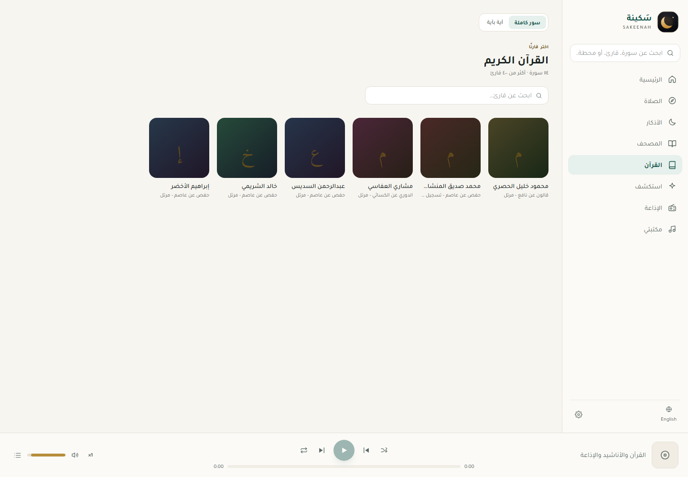
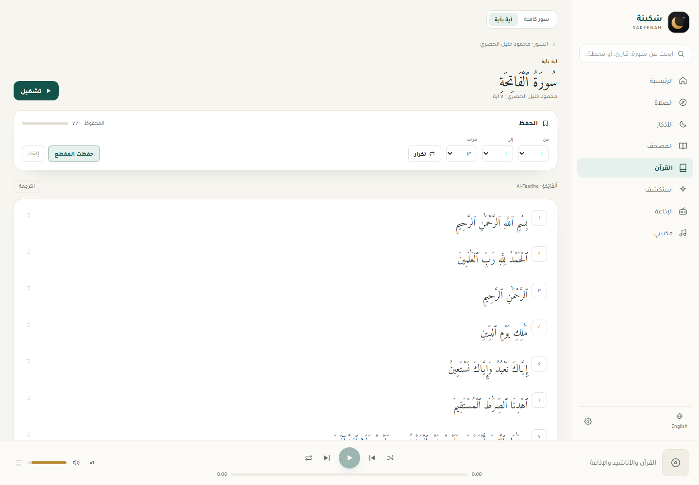
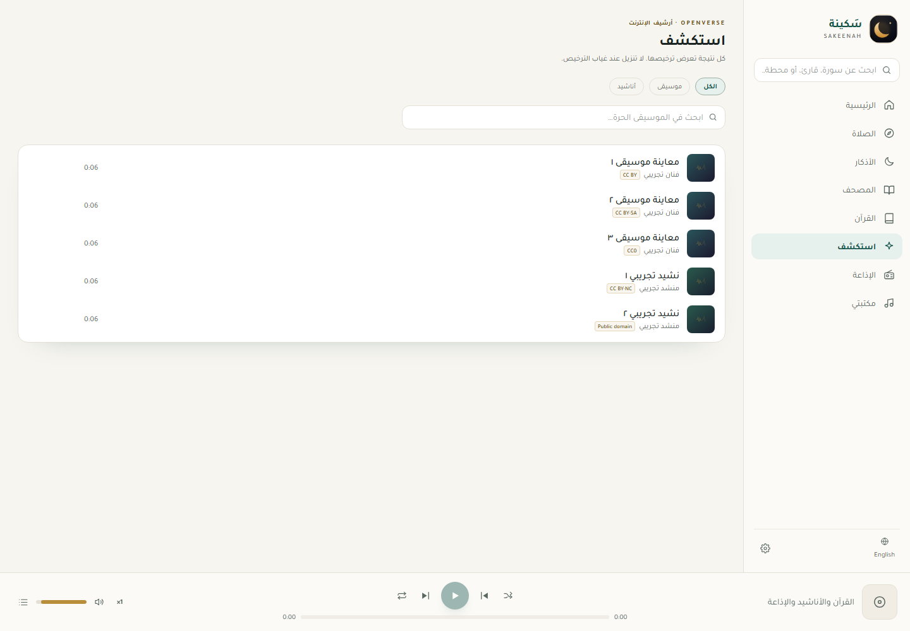
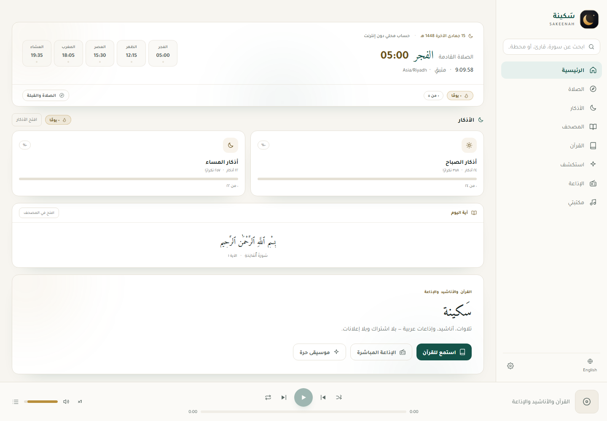
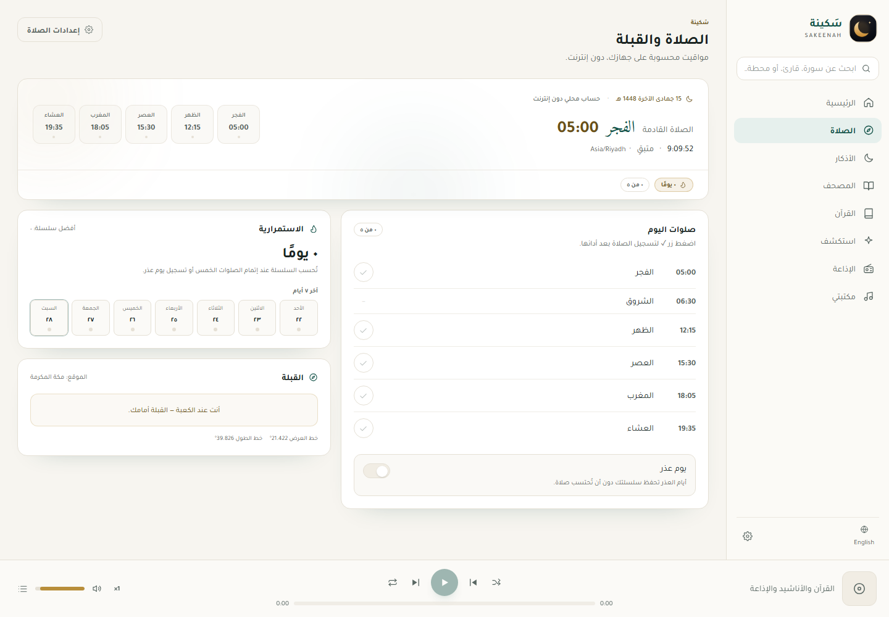
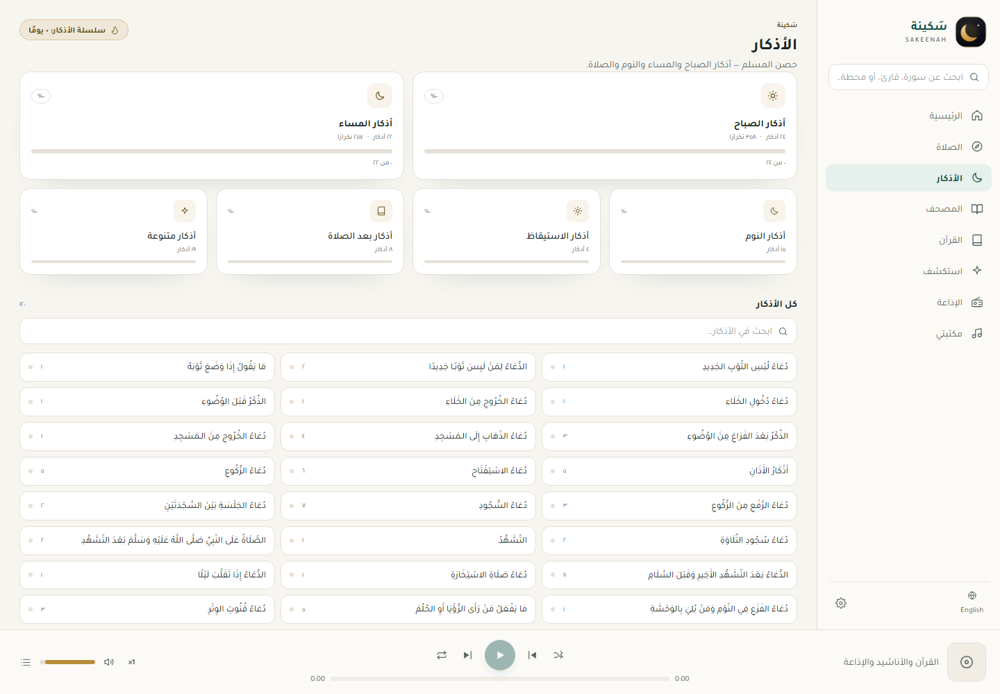
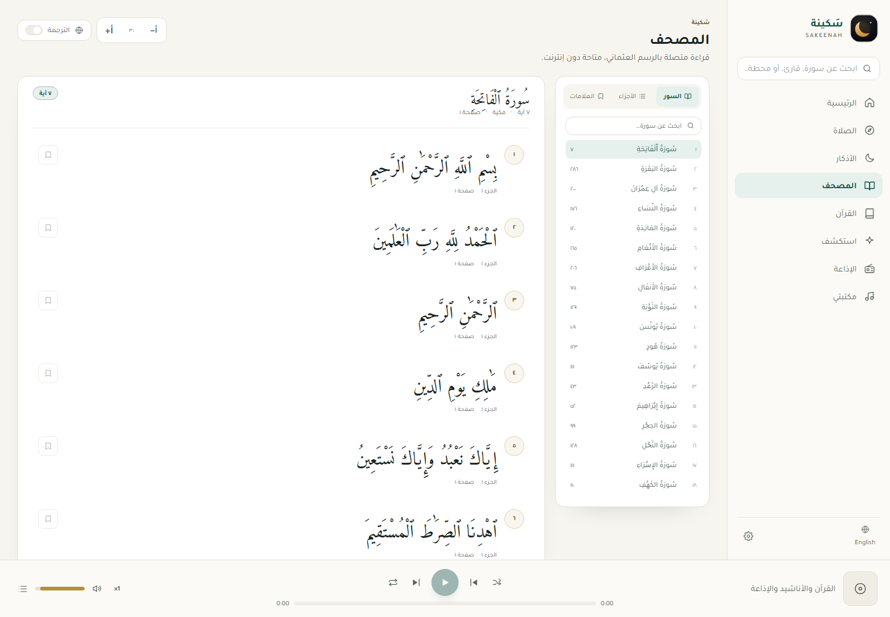
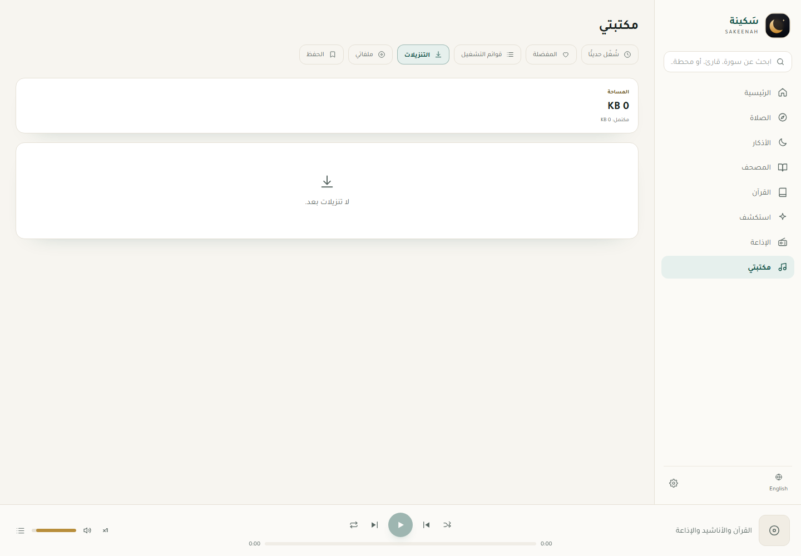
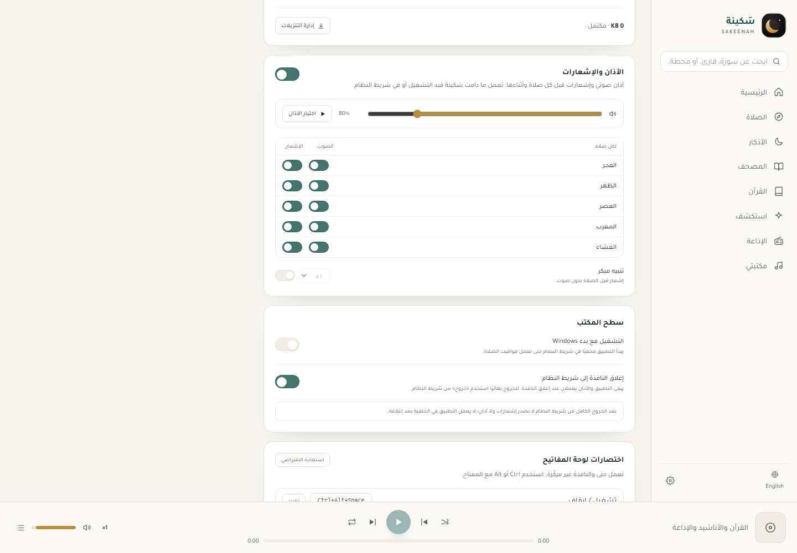
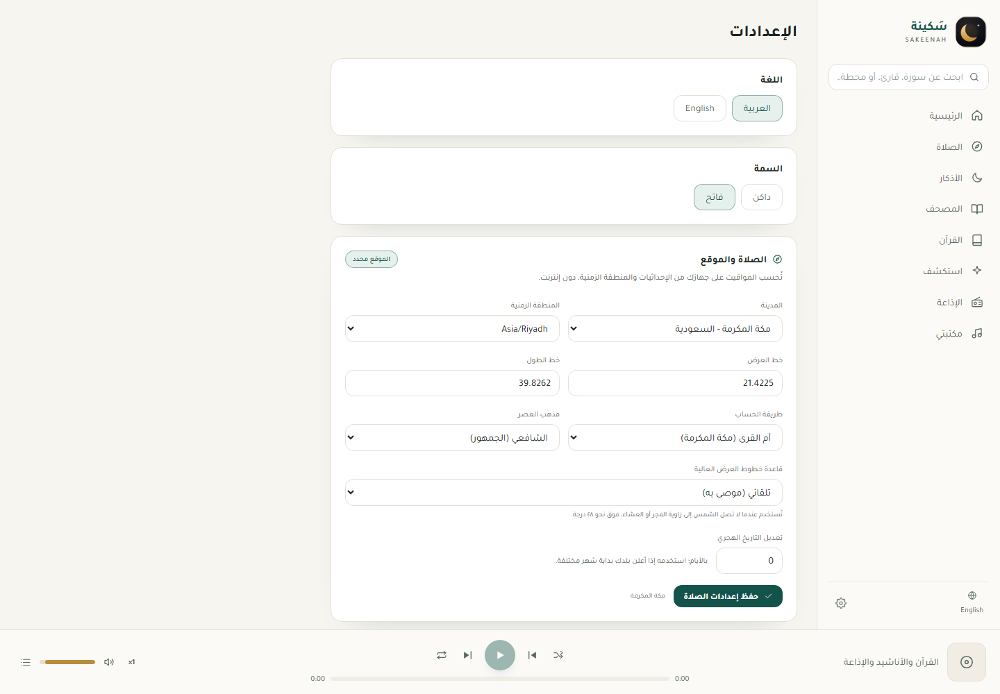

<div dir="rtl" align="right">

# سَكينة · Sakeenah

**تطبيق عربي خفيف لنظام ويندوز** — القرآن الكريم، ومواقيت الصلاة والقبلة، والأذكار، والأناشيد، والإذاعات العربية، وموسيقى بتراخيص مفتوحة.
مجاني، بلا إعلانات، بلا حساب، ومصمَّم ليبقى صغير الحجم وسريع الإقلاع.

سَكينة لا تستضيف أي محتوى. كل صوت يُبثّ من مصدره الأصلي، والحقوق لأصحابها.

**[الإصدارات والتحميل](https://github.com/mohamadtajas/sakeenah/releases)** · **[المصادر والتراخيص](#المصادر-والتراخيص)** · **[المساهمة](#المساهمة)**

---

## 🤍 رسالة من القلب

وُلد تطبيق **سَكينة** من رغبة صادقة في تقديم مساحة عربية هادئة ونقية للاستماع إلى القرآن الكريم، والأناشيد، والإذاعات العربية، بعيداً عن الإعلانات والتعقيد، ليكون رفيقاً خفيفاً يملأ أوقاتكم بالسكينة والجمال.

بُني هذا المشروع بالكامل باستخدام **DeepSeek**، وهو **مفتوح المصدر بالكامل** ومتاح للجميع. لأننا نؤمن أن أجمل المشاريع هي تلك التي تكبر بأيدي مجتمعها، فإن الباب مفتوح دائماً لكل من يحب أن يترك بصمته هنا؛ سواء باقتراح تعديل، أو العمل على ميزة جديدة، أو إصلاح مشكلة، أو إرسال **Pull Request (PR)**.

مساهمتك — مهما كانت بسيطة — تصنع فرقاً كبيراً. لنجعل من **سَكينة** أثراً طيباً ننتفع به جميعاً.

---

## ما هي سَكينة؟

تطبيق عربي بواجهة عربية أولاً (RTL) مع مبدّل عربي/إنجليزي واتجاه تلقائي، ووضعَي داكن وفاتح بهوية «المرمر والزمرد»، يجمع سبع ركائز:

1. **الصلاة والقبلة** — مواقيت محسوبة على جهازك دون إنترنت، وسجل صلوات وسلسلة استمرارية، وتاريخ هجري، واتجاه القبلة.
2. **الأذكار** — حصن المسلم كاملًا مع العدادات والتقدم وسلسلة أذكار يومية.
3. **المصحف** — النص العثماني كاملًا دون إنترنت، قراءة بالسور أو الأجزاء، مع العلامات وآخر موضع.
4. **القرآن الكريم** — تلاوات كاملة، ووضع آية بآية مع النص العثماني وأدوات حفظ.
5. **الإذاعات** — بث مباشر لمحطات عربية وإذاعات قرآنية.
6. **مكتبتك** — المفضلة، قوائم التشغيل، التنزيلات، والملفات المحلية.
7. **استكشف** — موسيقى وأناشيد بتراخيص Creative Commons من Openverse وأرشيف الإنترنت.

كل ذلك دون حساب، ودون إعلانات، ودون يوتيوب أو أدوات سحب البث — التطبيق قابل للتوزيع وعلى أرضية قانونية سليمة.

---

## لقطات من التطبيق

| القرآن الكريم | آية بآية مع أدوات الحفظ |
|---|---|
|  |  |

| استكشف المحتوى الحر | الرئيسية |
|---|---|
|  |  |

| الصلاة والقبلة | الأذكار |
|---|---|
|  |  |

| المصحف العثماني | إدارة التنزيلات |
|---|---|
|  |  |

| الأذان والإشعارات | الإعدادات |
|---|---|
|  |  |

---

## المزايا

### الصلاة والقبلة

- **مواقيت محلية دون إنترنت** تُحسب على جهازك من الإحداثيات والمنطقة الزمنية، بطرق أم القرى ورابطة العالم الإسلامي والهيئة المصرية وغيرها، وبمذهبَي الشافعي والحنفي للعصر، مع قاعدة تلقائية لخطوط العرض العالية.
- **مدن جاهزة** أو إحداثيات يدوية، ومنطقة زمنية كاملة (IANA) تراعي التوقيت الصيفي، مع تعديل التاريخ الهجري ±٣ أيام.
- **بطاقة الصلاة القادمة** في الرئيسية مع عدّاد تنازلي ومواقيت اليوم الخمسة.
- **سجل الصلوات** بنقرة واحدة لكل صلاة، و**سلسلة استمرارية** تبقى بعد إغلاق التطبيق، و**أيام عذر** تحفظ السلسلة دون احتساب صلاة.
- **التاريخ الهجري** (أم القرى) و**القبلة** بزاويتها الدقيقة من الشمال، مع قرص يدوي لتدوير الشمال الحقيقي.
- **صفحة الصلاة** تجمع المواقيت والسجل والسلسلة وآخر سبعة أيام والقبلة في مكان واحد.

### الأذكار

- **حصن المسلم كاملًا**: ٣٠٢ ذكر في ١٢٦ قسمًا (٦ أقسام مميزة و١٢٠ بابًا)، مع نص كل ذكر وتكراره ومصدره، من نسخة MIT © 2021 Abdellah SELLAM نُقلت من الكتاب المطبوع وقوبلت مع نسخة إلكترونية (انظر `data/README.md`).
- **أذكار الصباح والمساء والنوم والاستيقاظ وبعد الصلاة** في بطاقات مميزة، والكتاب كاملًا في فهرس قابل للبحث بالعنوان أو بنص الذكر.
- **قارئ تفاعلي**: اضغط في أي مكان لينقص العداد، مع الانتقال التلقائي عند اكتمال كل ذكر، وحفظ التقدم بعد كل نقرة.
- **سلسلة أذكار مستقلة**: إتمام أذكار الصباح أو المساء يحتسب اليوم، وتُصفَّر عند منتصف الليل المحلي.
- **بطاقات في الرئيسية** بنسبة الإنجاز وعداد الأيام المتتالية.

### المصحف

- **النص العثماني كاملًا** (١١٤ سورة، ٦٢٣٦ آية) مضمَّن في التطبيق، ويعمل دون إنترنت من أول تشغيل.
- **قراءة متصلة بالسور أو الأجزاء الثلاثين**، مع فهرس بحث للسور، وبسملة منفصلة كما وردت في مصدر تنزيل.
- **تكبير الخط** من ٢٠ إلى ٤٨، و**الترجمة الإنجليزية** (Sahih International) عند الاتصال مع بقاء النص العربي دون إنترنت.
- **العلامات المرجعية** وآخر موضع قراءة، مع استئناف تلقائي من حيث توقفت.
- **آية اليوم** في الرئيسية بتدوير يومي ثابت من النص المحلي.
- المصدر: مشروع تنزيل، بترخيص CC BY 3.0؛ النص لا يُعدَّل.

### القرآن الكريم

- أكثر من **٤٠٠ قارئ** من mp3quran.net وQuranicAudio، وكل السور الـ ١١٤، مع اختيار الرواية المتاحة لكل قارئ.
- **وضع آية بآية**: ٢٦ تلاوة مُنتقاة (مرتل، مجوّد، ومعلّم) من EveryAyah، وكل آية مقطع مستقل.
- **النص العثماني** مع تمييز الآية التي تُتلى، والتمرير التلقائي إليها، وإمكانية عرض الترجمة الإنجليزية.
- **أدوات الحفظ**: تحديد نطاق آيات، وتكراره من ١ إلى ١٠ مرات، ثم تعليمه كمحفوظ.
- تتبّع التقدم لكل سورة في **المكتبة ← الحفظ**، واستئناف من آخر آية لكل قارئ.
- سرعة التشغيل، والتكرار، والتنقل بين الآيات تعمل جميعها على مستوى الآية.

### الإذاعة والبحث

- محطات مباشرة من radio-browser.info مع فلاتر الدولة والتصنيف، واحتياطي من مرايا متعددة.
- إذاعات قرآنية من mp3quran.
- بحث موحّد في القرّاء والسور والمحطات، مع تطبيع عربي للكلمات (تجاهل التشكيل وتوحيد الألف والياء والتاء المربوطة).
- **بحث جزئي**: «حسن حفا» يجد «حسن حفار»، و«حصري» يجد «الحصري»، بغض النظر عن ترتيب الكلمات.
- **فلتر «حرة»** يوسّع البحث إلى Openverse وAudius دون إبطاء البحث الأساسي.

### استكشف — محتوى حر

- **Openverse**: فهرس صوتي بتراخيص Creative Commons يشمل Jamendo وFreesound، دون الحاجة إلى مفتاح API.
- **Audius**: شبكة بث مجانية بواجهة عامة، تضيف موسيقى عربية معاصرة لا توجد في الأرشيف.
- **أرشيف الإنترنت**: عناصر صوتية تُفكَّك إلى مقاطعها الفردية، مع ترخيص كل عنصر، للأناشيد والموسيقى.
- **النتائج تظهر تدريجياً**: كل مصدر (وكل عنصر أرشيف) يُضاف فور جهوزه بدل انتظار أبطأ مصدر.
- كل نتيجة تعرض ترخيصها، والتنزيل محجوب افتراضياً عند غياب الترخيص مع إمكانية تجاوزه من الإعدادات.
- إذا تعذّر أحد المصادر، تُعرض نتائج الآخر بدلاً من شاشة خطأ.

### مكتبتك

- **المفضلة** بزر القلب في كل صف وفي شريط التشغيل.
- **قوائم التشغيل**: إنشاء، إعادة تسمية، حذف، إضافة من أي صف، وإزالة من داخل القائمة.
- **إدارة التنزيلات**: طابور يسمح بثلاثة تنزيلات متزامنة، وتنزيل كل سور قارئ بضغطة مع تأكيد قبل المصاحف الكاملة، وإلغاء أو إعادة محاولة، واستكمال الملفات الجزئية بطلب Range. تعرض لوحة المساحة المكتمل والجزئي والملفات المستوردة، مع تحديد متعدد وحذف يزيل الملف والسجل معاً — ولا يحذف صفاً إذا فشل حذف ملفه. التنزيلات التي يقطعها إغلاق التطبيق تُعلَّم «متوقفة» وتُستأنف عند إعادة المحاولة. بعد الاكتمال يُشغَّل الملف المحلي تلقائياً بدلاً من الشبكة، وتُستخرج صورة الغلاف المضمَّنة إن وُجدت.
- **ترخيص غير معروف**: التنزيل محجوب افتراضياً حمايةً للحقوق، ويمكن تجاوزه بوعي من **الإعدادات ← التنزيلات**.
- **استيراد محلي**: اختر مجلداً واحداً أو أكثر، فيقرأ التطبيق وسوم ID3/FLAC/MP4 وأغلفة الصور المضمَّنة، ويعود إلى اسم الملف والمجلد عند غياب الوسوم. تُشغَّل الملفات عبر بروتوكول asset في Tauri، لذا يعمل التقديم والترجيع.

### ويندوز

- **جلسة وسائط نظامية (SMTC)**: شاشة القفل، وقائمة الصوت، وأزرار الوسائط في لوحة المفاتيح تتحكم في سَكينة وتعرض اسم المقطع.
- **أيقونة في شريط النظام**: الصلاة القادمة والعدّ التنازلي، إظهار/إخفاء النافذة، تشغيل/إيقاف، السابق، التالي، وخروج. الإخفاء لا يوقف الصوت.
- **الأذان والإشعارات**: أذان صوتي بترخيص CC0 مضمَّن، إشعار Windows لكل صلاة مع تنبيه مبكر اختياري، ومفتاح صوت وإشعار مستقل لكل صلاة، ومستوى صوت محفوظ. يُوقَف تشغيل الموسيقى مؤقتاً عند الأذان.
- **الإقامة في شريط النظام**: إغلاق النافذة يبقي التطبيق والأذان يعملان، مع خيار التشغيل مع Windows مخفيًا. الخروج الكامل من قائمة شريط النظام يوقف التطبيق، وبعدها لا تصدر إشعارات ولا أذان — لا خدمة خلفية بعد الخروج.
- **اختصارات عامة** تعمل حتى والنافذة غير مركّزة، وقابلة للتخصيص من **الإعدادات ← اختصارات لوحة المفاتيح**.
- **نسخة واحدة فقط**: تشغيل التطبيق مجدداً يعيد النافذة القائمة بدل فتح نسخة ثانية.

### الواجهة

- عربية أولاً (RTL) مع تبديل كامل إلى الإنجليزية.
- وضعان داكن وفاتح.
- خطوط عربية مستضافة ذاتياً: Tajawal وAmiri Quran (~١١٣ كيلوبايت).
- بلا مكتبة توجيه وبلا مكتبة حالة — Svelte 5 runes فقط.

---

## التثبيت

1. حمّل `Sakeenah_x.y.z_x64-setup.exe` من [صفحة الإصدارات](https://github.com/mohamadtajas/sakeenah/releases).
2. شغّل المُثبِّت. التثبيت يتم للمستخدم الحالي دون صلاحيات مدير.
3. المتطلبات: **ويندوز ١٠/١١ (64-bit)** و**WebView2** (مثبَّت مسبقاً على ويندوز ١١ وويندوز ١٠ المحدَّث).

> **قادم من Dandanah 0.1.0؟** تُنقل مكتبتك وتنزيلاتك تلقائياً عند أول تشغيل لسَكينة، ثم يمكنك إزالة التطبيق القديم.

> **ملاحظة صادقة:** المُثبِّت **غير موقَّع رقمياً** حالياً، لذا قد يعرض Windows SmartScreen تحذيراً عند أول تشغيل. التوقيع يحتاج شهادة Authenticode، وتوقيع التحديثات منفصل عنه ومطبَّق بالفعل.

---

## التشغيل من المصدر

المتطلبات:

- **Node.js** 20 أو أحدث
- **Rust** مستقر مع أداة MSVC
- **Visual Studio Build Tools** مع حمولة *Desktop development with C++*
- **WebView2 runtime**

```bash
npm ci
npm run app        # tauri dev — نافذة سطح المكتب مع إعادة تحميل فورية
```

بناء المُثبِّت:

```bash
npm run dist            # يتطلب مفتاح توقيع التحديثات (انظر أدناه)
npm run dist:unsigned   # مُثبِّت فقط، بلا حزمة تحديث موقَّعة
```

بناء التحديثات الموقَّعة محلياً:

```powershell
$env:TAURI_SIGNING_PRIVATE_KEY = Get-Content "$env:USERPROFILE\.tauri\dandanah.key" -Raw
$env:TAURI_SIGNING_PRIVATE_KEY_PASSWORD = ""
npm run dist
```

فحوصات الجودة:

```bash
npm run build
npx svelte-check --tsconfig ./tsconfig.json
cargo test --manifest-path src-tauri/Cargo.toml --lib
```

اختبار سطح المكتب الحقيقي (يستدعي IPC الفعلي في النافذة):

```powershell
$env:WEBVIEW2_ADDITIONAL_BROWSER_ARGUMENTS = "--remote-debugging-port=9333"
.\src-tauri\target\release\Sakeenah.exe
node scripts\desktop-smoke.mjs "C:\path\to\music"
```

---

## قياسات حقيقية

هذه أرقام مقيسة على نسخة الإصدار 0.5.1، لا وعوداً تسويقية (زمن الإقلاع والذاكرة من قياس 0.2.0؛ لم تتغيّر البنية):

| المقياس | القيمة |
|---|---|
| حجم المُثبِّت | **4.69 ميجابايت** |
| حجم الملف التنفيذي بعد التثبيت | 12.20 ميجابايت |
| زمن الإقلاع حتى جاهزية الواجهة | **776 مللي ثانية** |
| ذاكرة التطبيق نفسه | 38 ميجابايت |
| إجمالي الذاكرة الخاصة (التطبيق + WebView2) | **~221 ميجابايت** |
| إجمالي Working Set | ~399 ميجابايت |
| حزمة الواجهة | 501 كيلوبايت JS · 59 كيلوبايت CSS |
| اختبارات Rust | **104 اختباراً** |

**عن الذاكرة بصراحة:** الهدف المعلن كان ~100 ميجابايت، ولم يتحقق. التطبيق نفسه يستهلك 32 ميجابايت فقط، والباقي بنية Chromium/WebView2 (عمليات المتصفح وGPU والشبكة والعرض). خفض الرقم إلى 100 ميجابايت يتطلب واجهة أصلية (native) بدل WebView — أي إعادة كتابة، وليس تحسينا. الحجم وزمن الإقلاع تحققا؛ الذاكرة لا.

---

## البنية

```
src/                         واجهة Svelte 5 (runes، بلا مكتبة توجيه)
├─ lib/
│  ├─ components/            Icon, Artwork, SeekBar, TrackRow, PlayerBar, Sidebar,
│  │                         NextPrayer, PrayerTimeline, QiblaDial, AdhkarCards,
│  │                         AyahRow, DailyAyah…
│  ├─ views/                 Home, Worship, Adhkar, Reader, Quran, AyahMode,
│  │                         AyahPlayer, Explore, Radio, Search, Library,
│  │                         Settings, Credits
│  ├─ stores/                player, hifz, library, worship, adhkar, reader,
│  │                         nav, ui — runes
│  ├─ data/cities.ts         مدن جاهزة وإحداثياتها ومناطقها الزمنية
│  ├─ data/adhkar.json       أذكار حصن المسلم المولَّدة مع العدادات والمصادر
│  ├─ i18n/                  قواميس ar/en ودوال تنسيق الأرقام والتواريخ
│  ├─ api.ts                 أغلفة مطبوعة حول أوامر Tauri
│  └─ fonts.css              خطوط عربية مستضافة ذاتياً
└─ app.css                   رموز Tailwind v4 وأساسيات RTL

src-tauri/src/               الخلفية بلغة Rust
├─ providers/                مصدر واحد لكل ملف
│  ├─ mod.rs                 نموذج Track، تطبيع العربية، إزالة التكرار، التراخيص
│  ├─ mp3quran.rs            القرّاء، سيرفرات السور، إذاعات القرآن
│  ├─ everyayah.rs           كتالوج التلاوات الآية بآية وبناء الروابط
│  ├─ quranicaudio.rs        قرّاء QuranicAudio بأسمائهم العربية
│  ├─ quran_text.rs          النص العثماني والترجمة من AlQuran Cloud
│  ├─ openverse.rs           فهرس الصوت الحر (يشمل Jamendo)
│  ├─ audius.rs              بث موسيقى من Audius
│  ├─ archive.rs             أرشيف الإنترنت: عناصر تتحول إلى مقاطع
│  └─ radiobrowser.rs        دليل المحطات المباشرة مع مرايا احتياطية
├─ db/mod.rs                 مخطط SQLite، الترحيلات، التخزين المؤقت، السجل
├─ worship.rs               مواقيت الصلاة، التاريخ الهجري، القبلة، سلسلة الاستمرارية
├─ adhan.rs                  جدولة الأذان والتنبيه المبكر، شريط النظام، الإقامة والتشغيل التلقائي
├─ adhkar.rs                التحقق من بيانات الأذكار وسلسلة الأذكار اليومية
├─ quran.rs                 النص العثماني المضمَّن، slices للسور والأجزاء، آية اليوم
├─ downloads.rs              تنزيل متدفق مع أحداث تقدم
├─ library.rs                مسح المجلدات وقراءة الوسوم والأغلفة للملفات المحلية
├─ hotkeys.rs                اختصارات عامة قابلة للتخصيص والتحقق منها
├─ media.rs                  جلسة وسائط ويندوز (SMTC)
├─ commands.rs               سطح IPC
└─ lib.rs                    ربط التطبيق، الأيقونة، الاختصارات
```

### قرارات التصميم

- **بلا محرك صوت في Rust.** WebView2 هو Chromium: وسم `<audio>` يشغّل MP3/AAC/FLAC/Opus أصلاً، ويمنحنا Media Session بلا كود إضافي.
- **المزوّدون دوال نقية**، لا سجل trait objects. كل مزوّد يعيد `Vec<Track>`، وطبقة الأوامر تدمج وتزيل التكرار وتخزّن مؤقتاً. إضافة مصدر = ملف واحد وسطر في الأمر.
- **روابط البث تُحلّ عند التشغيل** ولا تُخزَّن، لأن بعض المصادر تصدر روابط قصيرة العمر.
- **بيانات وصفية تعمل دون اتصال.** قوائم القرّاء والمحطات تُخزَّن في SQLite مع صلاحية، وتُقدَّم نسخة قديمة عند انقطاع الشبكة.
- **الترخيص حقل بيانات، لا تذييل.** كل `Track` يحمل `license` و`licenseUrl` و`attribution`، فلا يمكن للواجهة عرض محتوى CC بلا ذكر صاحبه.
- **المواقيت تُحسب محلياً** بمكتبة `adhan` (نفس خوارزمية Adhan المرجعية)، والتاريخ الهجري بأم القرى، والقبلة بزاوية كروية — لا شبكة ولا خدمة خارجية.
- **الأذكار بيانات لا كود.** حصن المسلم ملف JSON مولَّد من مصدر MIT (`data/`)، والعدادات والتقدم والسلاسل في SQLite — بلا شبكة وبلا محتوى مستضاف.
- **المصحف نص لا شبكة.** النص العثماني مضمَّن من تنزيل (CC BY 3.0) دون تعديل، والترجمة وحدها تُجلب عند الطلب.

### معالجة النص العربي

`normalize_arabic` تحذف التشكيل والتطويل وعلامات الضبط القرآنية، وتوحّد الألف والياء والتاء المربوطة، فيتساوى «الأَنصَار» و«الانصار». ترتيب البحث يعتمد معاملاً يفضّل التطابق الكامل والكلمة الكاملة على تشابه المقاطع الثنائية، بعد أن أثبتت الاختبارات أن التشابه وحده يخلط بين أسماء قصيرة مثل «الحصري» و«الشريم».

---

## المصادر والتراخيص

| المصدر | المحتوى | الترخيص |
|---|---|---|
| [mp3quran.net](https://mp3quran.net) | تلاوات القرآن، أكثر من ٢٤٠ قارئاً، وإذاعات | متاح مجاناً |
| [QuranicAudio](https://quranicaudio.com) | ١٧٧ قارئاً إضافياً بأسمائهم العربية | متاح مجاناً |
| [EveryAyah](https://everyayah.com) | تلاوة آية بآية | متاح مجاناً |
| [AlQuran Cloud](https://alquran.cloud) | أسماء السور والنص العثماني والترجمة | بيانات مفتوحة |
| [Beautiful adhan](https://commons.wikimedia.org/wiki/File:Beautiful_adhan.ogg) | تسجيل الأذان المضمَّن (بدون تعديل) | CC0 1.0 — Adam-synagda |
| [radio-browser.info](https://www.radio-browser.info) | دليل محطات البث المباشر | بيانات مفتوحة (CC0) |
| [Openverse](https://openverse.org) | فهرس صوتي بتراخيص مفتوحة (يشمل Jamendo) | CC — حسب كل عمل |
| [Audius](https://audius.co) | بث موسيقى مجاني | بث مجاني — بلا ترخيص تنزيل |
| [Jamendo](https://www.jamendo.com) | موسيقى Creative Commons | CC — يتطلب ذكر المصدر |
| [Internet Archive](https://archive.org) | أناشيد وتسجيلات وموسيقى | حسب كل عنصر |

سَكينة **لا تحتوي مزوّد يوتيوب ولا أي أداة لسحب البث**. هذا يحافظ على قابلية التوزيع، ويصغّر المُثبِّت، ويُبقي المشروع على أرضية قانونية واضحة.

---

## اختصارات لوحة المفاتيح

داخل التطبيق:

| المفتاح | الإجراء |
|---|---|
| `Space` | تشغيل / إيقاف مؤقت |
| `→` / `←` | التالي / السابق |
| `↑` / `↓` | الصوت |
| `M` | كتم |

عامة (تعمل والنافذة غير مركّزة):

| المفتاح | الإجراء |
|---|---|
| `Ctrl+Alt+Space` | تشغيل / إيقاف مؤقت |
| `Ctrl+Alt+→` / `Ctrl+Alt+←` | التالي / السابق |
| أزرار الوسائط | تُوجَّه عبر جلسة وسائط ويندوز |

الاختصارات العامة قابلة للتغيير من **الإعدادات ← اختصارات لوحة المفاتيح**: اضغط «تغيير» ثم المفاتيح المطلوبة، واضغط `Backspace` لتعطيل اختصار. تُحفظ في قاعدة البيانات وتُطبَّق فوراً، مع رفض الاختصارات المتعارضة. قوائم شريط النظام بالعربية فقط.

---

## التحديثات والإصدارات

1. من **الإعدادات ← التحديثات** يتحقق التطبيق من ملف `latest.json` في آخر إصدار على GitHub.
2. إذا وُجد إصدار أحدث، ينزّل الحزمة الموقَّعة، ويتحقق من توقيعها بالمفتاح العام داخل `src-tauri/tauri.conf.json`، ثم يثبّتها ويعيد التشغيل.

نشر إصدار جديد:

```bash
git tag v0.1.1
git push origin v0.1.1
```

سير العمل `.github/workflows/release.yml` يبني على ويندوز، ويوقّع حزم التحديث، **وينشر الإصدار تلقائياً** على GitHub فور دفع الوسم. لا توجد خطوة يدوية، والتحديث يصبح مرئياً للنسخ المثبَّتة بمجرد نجاح السير.

الأسرار المطلوبة في المستودع:

| السر | القيمة |
|---|---|
| `TAURI_SIGNING_PRIVATE_KEY` | محتوى `~/.tauri/dandanah.key` |
| `TAURI_SIGNING_PRIVATE_KEY_PASSWORD` | كلمة مرور المفتاح (فارغة هنا) |

عنوان التحديثات مضبوط على `github.com/mohamadtajas/sakeenah`. إن نُقل المستودع، غيّر الرابط في `src-tauri/tauri.conf.json`؛ يجب أن يقدّم `latest.json` من آخر إصدار.

> احتفظ بنسخة احتياطية من المفتاح الخاص. فقده يعني تعذّر توقيع التحديثات مستقبلاً.

**مفتاح التوقيع الخاص لا يُرفع إلى المستودع أبداً** (مستثنى في `.gitignore`).

---

## القيود الحالية

نفضّل قولها صراحةً بدل تركها تُكتشف لاحقاً:

- **الذاكرة تتجاوز الهدف** (~234 ميجابايت خاصة بدل ~100). السبب WebView2، والحل إعادة كتابة بواجهة أصلية.
- **المُثبِّت غير موقَّع**، فيظهر تحذير SmartScreen حتى تُضاف شهادة.
- **التنزيلات مقطع واحد في المرة**، ولا يوجد تنزيل دفعة كاملة لسورة آية بآية.
- **لا توجد تصفية صوتية (EQ)** ولا تشغيل بلا فجوات (gapless).
- **النص العثماني يعمل دون اتصال فقط من التخزين المؤقت**؛ الترجمة تحتاج شبكة في أول مرة.
- **الكاتالوج العربي الحر رفيع**، لأن هذا هو المتاح فعلاً بتراخيص مفتوحة.
- **VPN مُدار** مثل Cloudflare WARP قد يحجب اتصالات التطبيق الأصلية (بينما تعمل المتصفحات). اسمح لسَكينة في سياسة VPN أو أوقفه مؤقتاً.

---

## المساهمة

المساهمات مرحّب بها، سواء كانت إصلاح خطأ، أو تحسين ترجمة، أو مزوّد محتوى جديد، أو تحسين أداء.

1. افتح Issue للنقاش قبل التغييرات الكبيرة.
2. أنشئ فرعاً من `master`.
3. ثبّت الاعتماديات: `npm ci`.
4. نفّذ الفحوصات قبل الإرسال:

```bash
npm run build
npx svelte-check --tsconfig ./tsconfig.json
cargo test --manifest-path src-tauri/Cargo.toml --lib
```

5. أرسل Pull Request، واشرح **ماذا** تغيّر و**لماذا**، وأرفق لقطات شاشة لتغييرات الواجهة.

ملاحظات للمساهمين:

- اتبع نمط الكود المحيط، وأبقِ التعليقات موجزة وتشرح السبب لا الوصف.
- أي نص جديد في الواجهة يحتاج مفتاحاً في `src/lib/i18n/dict.ts` بالعربية والإنجليزية معاً.
- أي مصدر محتوى جديد يجب أن يعيد `Track` كاملاً بحقول الترخيص، وألا يخزّن روابط البث.
- أضف اختباراً لكل منطق قابل للاختبار (تطبيع، ترتيب، بناء روابط، قاعدة بيانات).

أفكار مناسبة كبداية: تنزيل دفعة كاملة لسورة، دعم أزرار وسائط إضافية، تحسين واجهة الحفظ، وإضافة مزوّد محتوى عربي حر.

---

## تطبيق الجوال

يعيش تطبيق Flutter في [`mobile/`](mobile/) ويستهدف Android وiOS. المرحلة الحالية M0: الهيكل والتصميم والخطوط؛ راجع [`mobile/README.md`](mobile/README.md) للبناء والتشغيل ولقطات الشاشة.

---

## الترخيص

- **الكود:** MIT — انظر [LICENSE](LICENSE).
- **المكتبات:** إشعارات الحزم مذكورة في [THIRD_PARTY_NOTICES.md](THIRD_PARTY_NOTICES.md).
- **بيانات الأذكار:** نسخة HisnElMuslim بترخيص MIT، © 2021 Abdellah SELLAM — انظر [data/LICENSE.md](data/LICENSE.md).
- **النص القرآني:** Tanzil Quran Text (Uthmani) بترخيص CC BY 3.0، © Tanzil Project — انظر [data/QURAN_LICENSE.md](data/QURAN_LICENSE.md).
- **المحتوى:** ملك لأصحابه، وكل مصدر مذكور أعلاه بترخيصه.

---

## شكر وتقدير

إلى كل من سجّل تلاوة، أو أرشف تسجيلاً، أو نشر عملاً بترخيص مفتوح، أو كتب سطراً في مكتبة مفتوحة المصدر: هذا التطبيق قائم على عملكم.

وبُني هذا المشروع بالكامل باستخدام **DeepSeek** — ومفتوح للجميع ليَكبُر بأيدي مجتمعه.

</div>


