# Sakeenah Mobile

Flutter client for Android and iOS. The desktop app lives in the repository root;
this directory is an independent Flutter project that shares the brand, content
and prayer calculations but not the desktop runtime.

## Status

Phase **M7** - widgets, polished audio, adhkar reminders and adhan sounds,
with the Alabaster / Sanctuary Emerald visual system.

- Arabic-first UI with a persistent AR/EN switch and full RTL/LTR mirroring
  through `flutter_localizations` and generated ARB accessors.
- Bottom navigation: Dashboard, Mushaf, Adhkar, Audio.
- Alabaster light theme: canvas `#F7F5F0`, white surfaces, emerald primary
  `#145349` with soft `#E6F0ED`, gold accent `#B88E3B` (gold ink `#6B511A`
  for small labels), ink `#1B2422`, muted `#5A6864` and line `#E5E0D5`.
  The Sanctuary dark theme uses deep green-black surfaces, light emerald
  actions and a warmer gold accent.
- 16 px cards, 12 px controls, an 8 px spacing rhythm and emerald/gold focus
  and active states, with reduced-motion-aware transitions.
- Tajawal for UI text and Amiri Quran for Quranic text, both bundled offline.
- Drift database with tested schema migrations and bundled content seeding.
- Offline prayer methods, Hijri conversion and qibla bearings.
- Device location through `geolocator` with a first-run Arabic permission
  sheet and a Settings refresh; manual city selection remains the fallback.
- Adhkar catalog with featured sections, search, per-section progress and a
  morning/evening streak, plus a full-screen counter with haptics,
  auto-advance and persisted per-item progress.
- Quran catalog with surah/juz tabs, search, bookmarks and resume; a
  continuous Uthmani reader with bookmark toggles, 20–44 pt font sizing and
  a deterministic daily ayah.
- Quran audio with eight EveryAyah reciters, a surah queue, mini-player,
  full player, speed and repeat; `audio_service` publishes the media session
  for background and lock-screen controls. The full player's main slider spans
  the whole surah with per-ayah ticks and the current ayah text, using a
  bundled duration index for every reciter (with a safe fallback when a
  reciter/surah is missing).
- Islamic radio: a curated, HTTPS-only whitelist of Quran and Islamic stations
  in the Audio tab, with a live badge and no misleading seek/skip controls.
- Offline audio downloads: one surah or an entire reciter (no storage cap),
  with progress, cancel, stored-size display and per-surah deletion. A
  completed reciter folder is a complete local copy of the Quran, and playback
  prefers local files automatically.
- Anasheed browsing through Openverse (CC-licensed audio from Wikimedia
  Commons, Freesound and Jamendo) with per-track licence and source labels.
- Android home-screen widgets in three sizes: 5×1 next prayer with a one-tap
  prayed action, 5×2 prayer times with today's marks, and 3×3 streak.
- Per-prayer adhan and pre-alert notifications scheduled on-device for two
  weeks (every prayer has its own pre-alert offset), with three selectable
  bundled adhan recordings (two CC0, one public domain) on Android and iOS,
  a silent option, exact-alarm support and a silent channel for pre-alerts.
  Adhan channels use the Android alarm audio stream, so the call stays audible
  even when notification or media volume is low or muted.
- Optional adhkar reminders: morning after Fajr, evening after Asr and a fixed
  sleep reminder, all off by default, with a separate notification channel.
- A Sources and licences page with the Tanzil attribution, all adhan recording
  credits and licences, Hisn al-Muslim and font licences, and live source links.

The full Uthmani Quran (114 surahs, 6236 ayahs) and Hisn al-Muslim (126
categories, 302 items) are seeded from bundled assets on first launch. Adhkar
and Quran reading work fully offline; Quran audio streams from EveryAyah and
falls back to downloaded files. Anasheed and radio need a network connection;
both degrade to a clear error without crashing.

## Release builds

`flutter build apk --release` is smoke-tested in CI. AGP 9 shrinks resources in
release builds, so `res/raw/keep.xml` explicitly keeps all three adhan sounds
that `flutter_local_notifications` looks up by name; the main manifest declares
`INTERNET` for EveryAyah streaming and radio. The CI job fails if a sound or
the permission is missing from the release APK. iOS notification sounds are
29-second mono CAF files, within the system's 30-second limit.

## Downloads and widgets

Audio downloads live under the app support directory in
`audio/<reciter>/<surah>/<ayah>.mp3`. "تنزيل كل السور" fetches every ayah for
the selected reciter with no size cap, so the folder becomes a complete local
copy that can be copied off the device. Downloads skip existing files and can
be stopped and resumed.

Android widgets are declared at 5×1 (next prayer), 5×2 (prayer times) and 3×3
(streak). Add them from Settings → Home-screen widgets or from the launcher's
widget picker. Scheduling refreshes them at every prayer and at midnight.

## Data layer

```
lib/data/
  cities.dart              59 offline city presets
  audio/                   EveryAyah catalog, engine, playback controller,
                           offline downloads
  db/app_database.dart      Drift schema v4 (content + user state)
  location/                 device fix, timezone channel, onboarding helper
  models/                   Surah, Ayah, Adhkar, Quran bookmark, local date
  widgets/                  widget-data publisher and native bridge
  repositories/             content, prayer log, adhkar practice, Quran reader
  seed/                     QuranSeeder, AdhkarSeeder
  worship/                  settings, schedule, prayer/practice logs, Hijri, qibla,
                            notification planning and adhan scheduling
  app_services.dart         startup seeding and shared repositories
```

- `ContentBootstrap` loads `assets/data/quran.json` and
  `assets/data/adhkar.json` once and seeds them in a single transaction.
  A stored `content_version` plus complete row counts skips all asset I/O on
  later launches; bumping the version refreshes bundled content while keeping
  user state.
- Schema v1 held Quran/adkhar content; v2 added settings, bookmarks, reader
  position, adhkar progress/logs and the prayer log; v3 stores prayer and
  adhkar streak days as `YYYY-MM-DD` local dates; v4 scopes adhkar counters to
  a local day so sections reset each morning. Step-by-step migrations and a
  generated schema test cover v1 → v4.
- Quran text is inserted verbatim; tests compare every stored row against the
  bundled source, verify the asset is byte-identical to the desktop bundle,
  and check the Tanzil XML hash.
- Calculation methods match the desktop catalogue (Umm al-Qura, MWL, Egyptian,
  Karachi, Dubai, Moonsighting, ISNA, Kuwait, Qatar, Singapore, Tehran,
  Turkey), with the seventh-of-the-night high-latitude rule. Returned times are
  wall-clock values on the requested local date for the supplied UTC offset.
- Hijri dates use Umm al-Qura tables and support the desktop-style day
  adjustment. Qibla bearings are computed offline from coordinates; the M2 dial
  shows the bearing from true north, with live device heading planned for polish.
- PrayerScheduleService resolves the selected IANA timezone (including DST)
  and computes today/tomorrow so the next prayer rolls over correctly at
  midnight. PrayerLogRepository stores each prayer status and computes the
  current/best streak from YYYY-MM-DD local dates; excused days preserve a
  chain.

Attribution and licence files live next to the assets:
`QURAN_LICENSE.md` (Tanzil, CC BY 3.0) and `ADHKAR_LICENSE.md`
(HisnElMuslim, MIT). Package and font notices are listed in
[`THIRD_PARTY_NOTICES.md`](THIRD_PARTY_NOTICES.md). `scripts/build-quran.mjs`
writes both the desktop and mobile Quran bundles from the same XML.

## Reliability

- Native SQLite comes from `sqlite3` 3.x native assets; no platform channel
  setup is required.
- Startup runs behind a catch-all: a failed database open or seed shows an
  Arabic recovery screen with a retry button instead of a blank splash.
- Seeders skip completed collections; the version gate avoids reading the
  1.7 MB Quran asset on every launch.
- Tests use in-memory databases, real bundled assets and generated migration
  snapshots. M2 adds schedule/timezone matrices, prayer logging and streak
  tests, plus dashboard and settings widget tests. M3 adds adhkar repeat,
  auto-advance, resume, morning/evening streak, Arabic search, reset and
  2x-text layout tests. Location tests cover permission outcomes, an invalid
  timezone, onboarding suppression and the Settings save path. M4 adds reader
  position, bookmark, font-size, catalog, daily-ayah and continuous-reader
  tests. M5 adds audio URL/queue, playback controller, mini-player, full
  player and download-store tests. M6 adds adhan preference, planner,
  scheduler and settings tests. M7 adds widget-data publishing and
  prayed-action tests. A 2× text pass covers the dashboard, adhkar, Quran
  catalog/reader, audio pages, mini-player, settings and adhan sections, plus
  the full shell at 320×640.

## Requirements

- Flutter 3.50.1 stable (Dart 3.14).
- JDK 17 for the Android build.
- Android SDK with platform 36, build-tools 36.0.0 and NDK 28.2.13676358.
- Xcode 16+ on macOS for the iOS compile check.

The project targets `app.sakeenah.mobile`, `minSdk 26`, `targetSdk 36`.

## Commands

```bash
flutter pub get
flutter gen-l10n          # also runs automatically on pub get/build
flutter analyze
flutter test
flutter build apk --debug
flutter build ios --debug --no-codesign   # macOS only
```

The debug APK is written to `build/app/outputs/flutter-apk/app-debug.apk`.

## Layout

```
lib/
  app.dart                  MaterialApp, locale and theme mode
  shell/app_shell.dart      Bottom navigation and app bar
  features/                 dashboard, quran, adhkar, audio, settings
  l10n/                     Arabic template and English translation
  theme/sakeenah_theme.dart Colour tokens and ThemeData
  widgets/                  shared cards and placeholders
assets/fonts/               bundled fonts and their OFL licences
```

## Screenshots

Captured on an Android 16 (API 36) emulator at 1080x2400 in Arabic RTL.

| Dashboard | Mushaf | Adhkar |
|---|---|---|
| 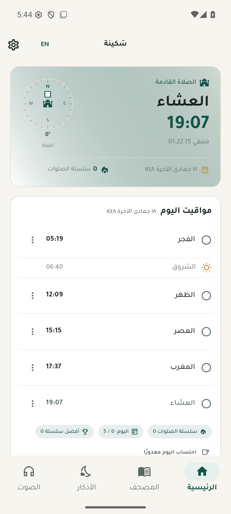 | 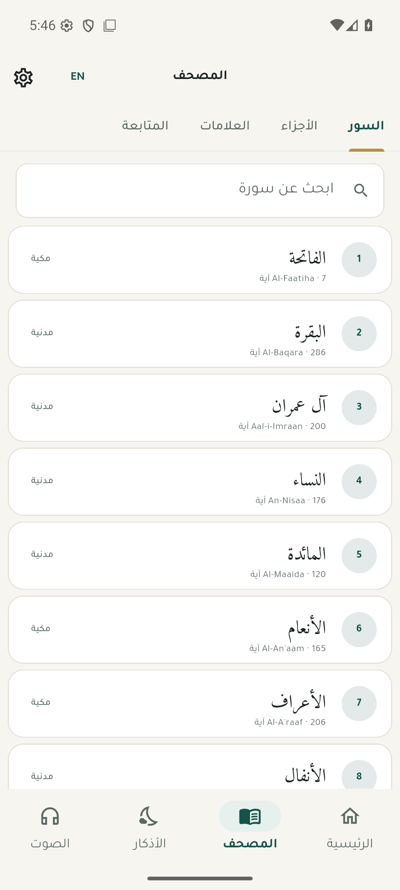 | 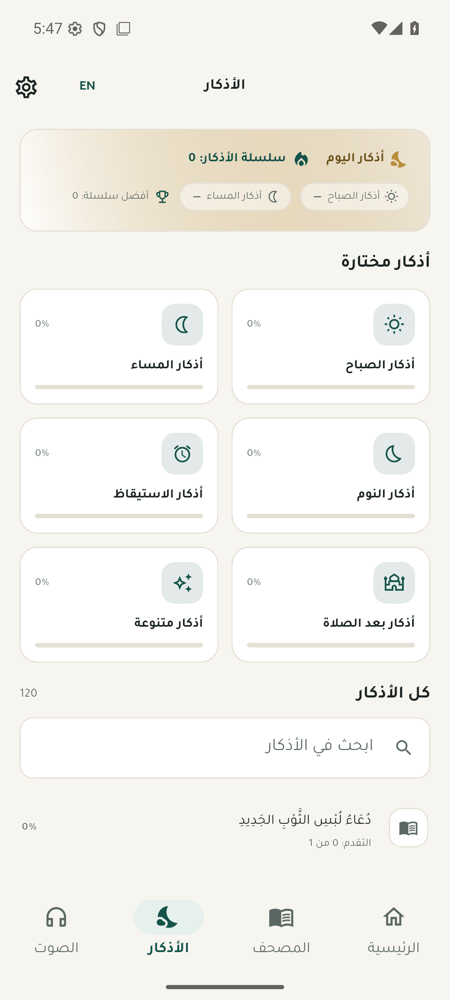 |

| Audio | Settings (dark) | Settings (light) |
|---|---|---|
| 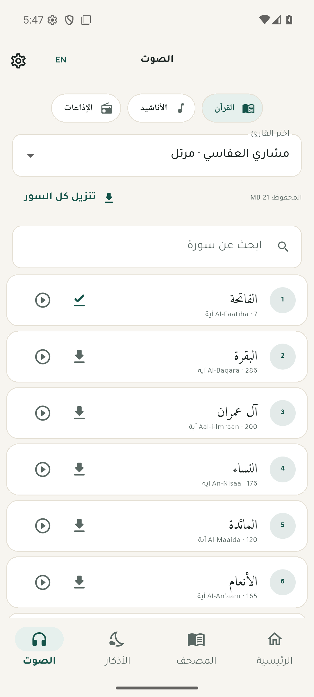 | 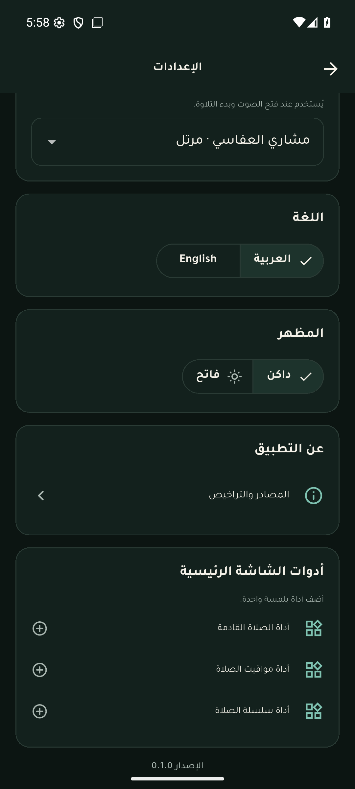 | 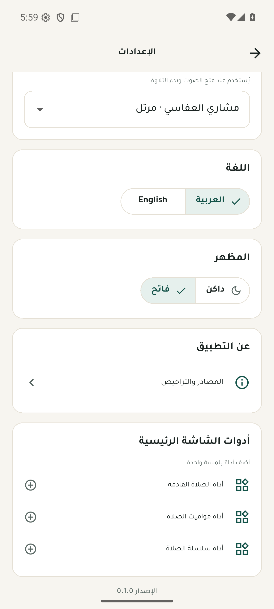 |

| Quran reader | Audio player |
|---|---|
| 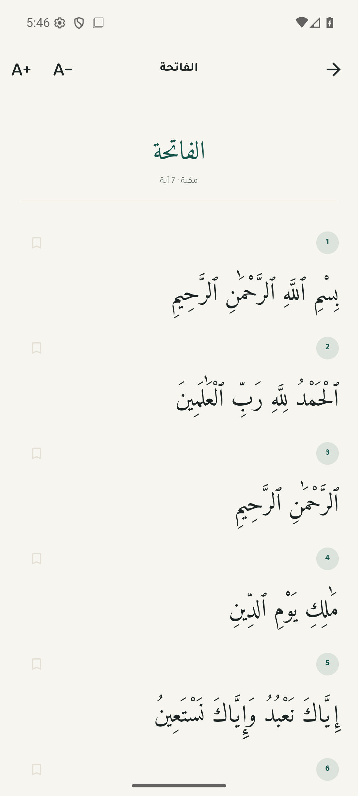 | 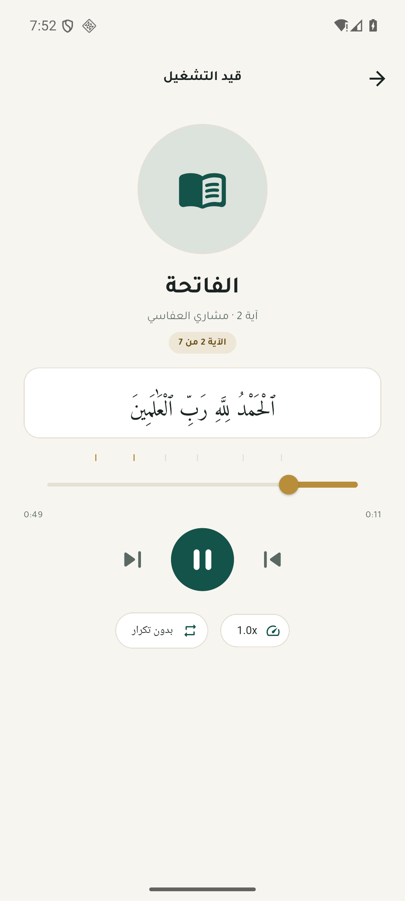 |

| Anasheed | Downloads |
|---|---|
| 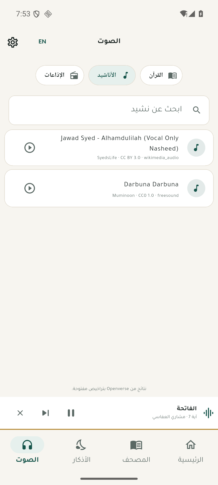 |  |

| Islamic radio | Adhan settings |
|---|---|
| 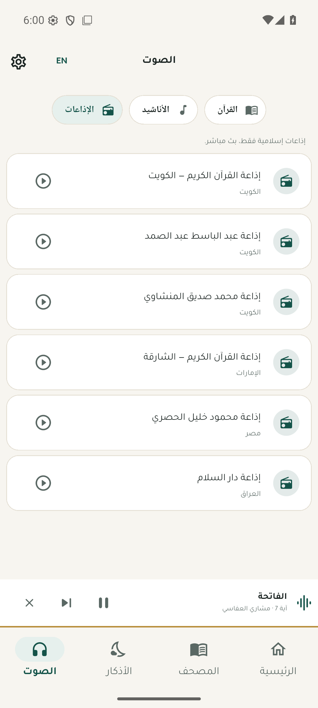 | 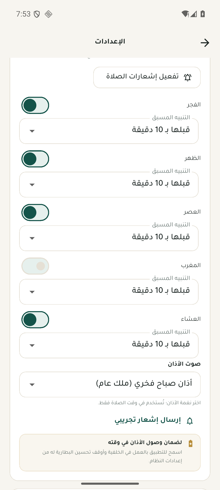 |

| Offline audio error |
|---|
|  |

| Adhkar counter |
|---|
| 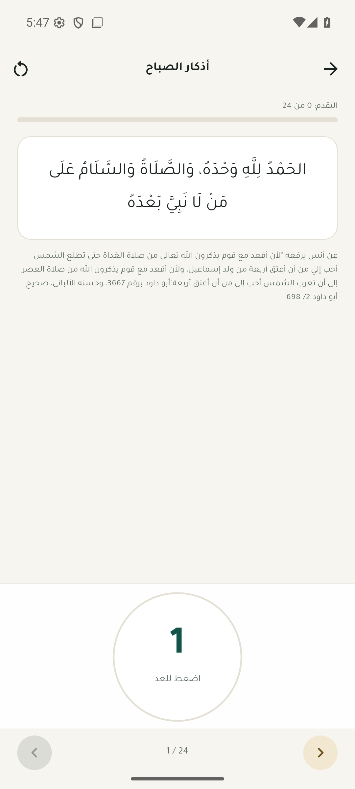 |

| Location onboarding |
|---|
|  |

## Localisation

`lib/l10n/app_ar.arb` is the template. Add a key there first, then mirror it in
`app_en.arb`. Arabic is the default locale; English ships with the app and both
directions are mirrored through `MaterialApp.locale`. The header AR/EN switch
and Settings language control persist the choice in `ui.locale`, and unsupported
saved values fall back to Arabic.

## CI

`.github/workflows/mobile.yml` runs analyze, tests and a debug APK build on
Ubuntu, plus an unsigned iOS compile on macOS. Both jobs must stay green before
a mobile release.
